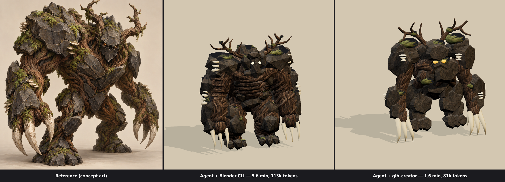
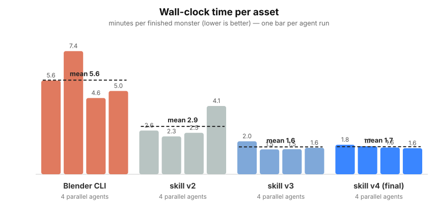
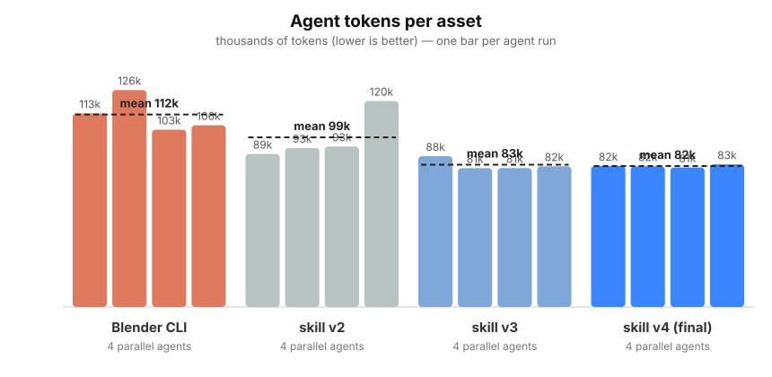
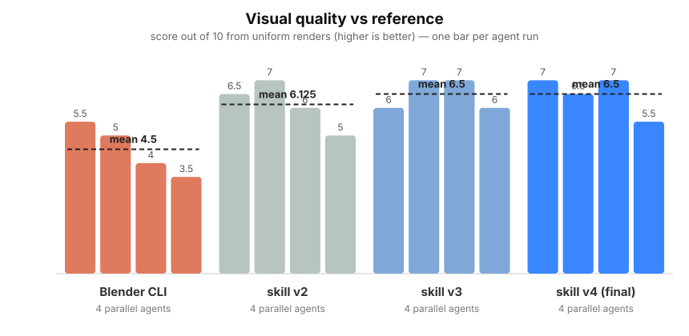

# glb-creator: Claude benchmark demo

A head-to-head experiment: can the [glb-creator agent skill](https://github.com/asilvas/skill-glb-creator) beat the classic **Blender headless CLI** workflow for agent-driven 3D asset creation — on speed, tokens, and quality?



## The experiment

Sixteen Claude (sonnet) subagents received the identical brief: *recreate the forest-warden concept art ([assets/reference.png](assets/reference.png)) as a single grounded, textured, skinned GLB with one 1.2 s "attack" clip*, using the prepared PBR texture sets in [assets/textures](assets/textures). Only the PIPELINE paragraph differed between arms. Four agents ran in parallel per arm:

1. **Baseline** — Blender 5.2 headless CLI (`--background --python`), render-to-PNG previews.
2. **skill v2** — glb-creator after the first revamp (one-shot `dev` command, contact sheets, API-complete SKILL.md).
3. **skill v3** — + numeric dimension reporting, `scale()`, pitfalls guide.
4. **skill v4 (final)** — + forgiving `tube()` radii, proportion-landmark guidance.

All 16 runs delivered valid GLBs (0 Khronos errors) with embedded textures and a working attack clip.

## Results

| mean per asset | Blender CLI | skill v2 | skill v3 | skill v4 |
|---|---:|---:|---:|---:|
| Tokens | 112,034 | 98,761 | 82,852 | **82,081 (−27%)** |
| Minutes | 5.64 | 2.87 | 1.64 | **1.65 (3.4× faster)** |
| Tool calls | 24.8 | 22.5 | 13.0 | **14.3** |
| Visual quality /10 | 4.5 | 6.1 | 6.5 | **6.5** |





The jump from v2 to v3 came from feeding friction back into the skill: agents had been writing their own bounds-measuring scripts and losing build cycles to out-of-range tints, so the `dev` summary grew `rest.height`/`size`/`minY`, `scale()` was added, and a pitfalls section documented every observed mistake. v4 confirmed convergence — its four runs landed within a 2k-token band.

## Repo layout

- `assets/` — the reference image and prepared PBR maps (from the [codex demo](https://github.com/asilvas/skill-glb-creator-codex-demo)).
- `skills/glb-creator/` — the skill as benchmarked (synced back to the [skill repo](https://github.com/asilvas/skill-glb-creator)).
- `runs/<arm>-<n>/` — each subagent's isolated workdir: `monster.glb`, `notes.md`, recipes/scripts, preview renders.
- `results/metrics.json` — per-run tokens, seconds, tool calls, iterations, quality scores and notes.
- `results/eval/` — uniform re-renders of all 16 GLBs (same renderer/camera/lighting) used for quality scoring.
- `results/charts/` + `tools/` — the charts, hero image, animated attack, and the scripts that build them.
- `results/protocol.md` — the exact protocol and its confounds.

## Reproduce

```sh
bun install --cwd skills/glb-creator          # or: cd skills/glb-creator && bun run setup
cd skills/glb-creator && bun run test         # library self-tests
bun run dev -- tmp/smoke.ts                   # one-shot build → validate → contact sheet
```

To rerun the benchmark, give each subagent an isolated copy of `skills/glb-creator` and the brief in `results/protocol.md`, then aggregate harness telemetry per run and re-render deliverables with `tools/eval.ts`.

Caveats: one task, one host (Windows 11, Ryzen 9 9950X3D, RTX 5090, Bun 1.4.4, Blender 5.2), different renderers between pipelines, single-reviewer quality scores, model nondeterminism. Texture generation was outside both pipelines.

[MIT license](LICENSE).
